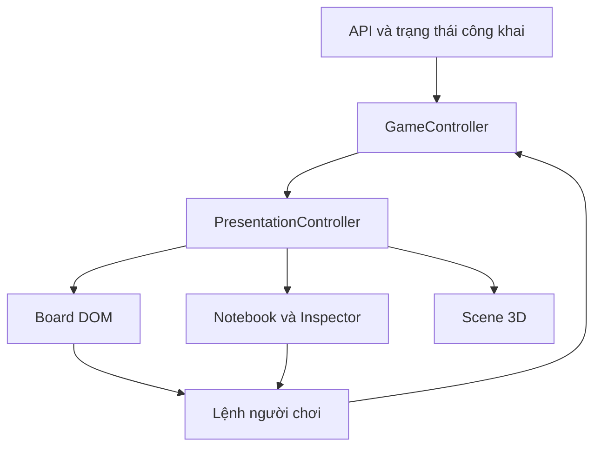

# GRIDUCTIVE — DESIGN 3D

## The Midnight Archive: bàn điều tra trong ca trực đêm

| Thuộc tính | Giá trị |
| --- | --- |
| Phiên bản | 1.0 |
| Ngày | 25/11/2026 |
| Trạng thái | Đặc tả đề xuất để triển khai; chưa phải mô tả một bản 3D đã chạy |
| Repository | [khang1108/griductive](https://github.com/khang1108/griductive) |
| Source đã đối chiếu | Nhánh main tại commit [1ef81d1](https://github.com/khang1108/griductive/commit/1ef81d1c0c138660d3c19857a3079f805d79128f) |
| Nền tảng ưu tiên | Web desktop; có bố cục tablet, mobile và chế độ DOM dự phòng |
| Ngôn ngữ tài liệu | Tiếng Việt; nhãn UI ví dụ giữ tiếng Anh theo giao diện hiện có |
| Asset mặc định | Bốn model CC0 của Poly Haven đã tải và kiểm tra cấu trúc |
| Asset trả phí | GlenFX là lựa chọn nâng cấp mỹ thuật, chưa phải dependency bắt buộc |
| Preview | Ảnh concept được tạo riêng để minh họa bố cục và ánh sáng; không phải ảnh render từ các GLB đã nhập |

> Mục tiêu: biến quá trình suy luận thành thao tác với hồ sơ thật — chọn lời khai, soi vùng liên quan, xem nghi phạm, xác nhận kết luận và mở thêm chứng cứ. Không gian 3D tạo bối cảnh; thông tin để giải bài luôn rõ ràng.

## 1. Các quyết định thiết kế chính

| Chủ đề | Quyết định cho phiên bản đầu |
| --- | --- |
| Hướng mỹ thuật | Noir có chất liệu: gỗ tối, giấy ngà, kim loại cũ, ánh đèn ấm và ánh cửa sổ lạnh |
| Không gian | Một bàn điều tra cố định trong một góc phòng; camera có các vị trí được thiết kế sẵn |
| Nội dung 3D | Bàn, đèn, sổ và đạo cụ dùng model có nguồn gốc rõ ràng |
| Bảng nghi phạm | Một bảng HTML có chiều sâu CSS, neo vào mặt bảng trong cảnh 3D |
| Sổ chứng cứ | Panel HTML độc lập, chữ rõ; model sổ chỉ làm đạo cụ hoặc phần trang trí |
| Luật chơi | Tọa độ cố định, lời khai đã mở nói thật, trạng thái chưa mở không được lộ qua hình ảnh |
| Hiệu ứng trọng tâm | Focus vùng chứng cứ, nhấc hồ sơ, đóng dấu kết luận, nhận lời khai mới |
| AI | Replay là hạng mục riêng, cần dữ liệu từng bước có cấu trúc |
| Khả năng tiếp cận | Hoàn thành toàn bộ vòng chơi bằng bàn phím và khi giảm chuyển động |
| Phạm vi đầu tiên | Một vụ 4×4 chơi trọn vẹn, cộng kiểm tra bố cục 3×3 và 5×5 |

Các thông số về kích thước, thời lượng, dung lượng và hiệu năng bên dưới là **mục tiêu thiết kế để đo khi triển khai**, trừ những giá trị được ghi rõ là đã kiểm tra từ source hoặc file asset.

## 2. Hiện trạng đã xác minh từ repository

| Phần | Hiện trạng | Hệ quả đối với thiết kế |
| --- | --- | --- |
| Frontend | React 19, TypeScript, Vite, Tailwind 4. [R1] | Tiếp tục dùng hệ component hiện tại; bổ sung lớp cảnh 3D |
| CardTile | Card một mặt, đổi màu, hover nâng/scale; chưa dùng các utility flip trong CSS. [R2] | Thiết kế chuyển động hồ sơ là phần triển khai mới |
| Board | Card cố định 146×174px; khoảng cách hàng 12px. [R3] | Năm hàng cần khoảng 918px trước header/padding; phải có compact mode |
| Evidence | Đã có owner_coord, clue_id, type, text và referenced_coords. [R4] | Có thể làm focus vùng và liên hệ lời khai ngay từ payload hiện tại |
| Manual verdict | API gọi submit_manual_verdict, đối chiếu với đáp án ẩn. [R5], [R6] | Chưa thể gọi mọi lượt xác nhận của người chơi là một chứng minh logic |
| Hint | Route hiện gợi ý xem một lời khai; chưa kết nối suggest_next. [R5], [R7] | Hint có chứng minh cần nâng cấp luồng dữ liệu |
| Auto Solve | Solver đã có; API trả trạng thái cuối và trace dạng chuỗi. [R5], [R8] | Chưa có playback từng bước dùng trực tiếp |
| Định danh phiên | Serializer có revision; chưa trả session_id. [R4] | Revision đơn lẻ không đủ chống phản hồi cũ sau restart |
| Phục vụ frontend | Backend mount frontend/dist khi thư mục build tồn tại. [R5] | Các thay đổi frontend cần được build lại trước khi chạy qua Python |

**Quy ước trạng thái trong tài liệu:**

- **Hiện có:** hành vi hoặc dữ liệu đã đối chiếu trong source.
- **Đã chuẩn bị:** asset đã tải, đóng gói và kiểm tra file.
- **Đề xuất:** hành vi, component, API hoặc tiêu chí cần triển khai.
- **Mở rộng:** hạng mục sau khi vòng chơi đầu tiên đã đạt chất lượng.

## 3. Hướng mỹ thuật và nguyên tắc chống cảm giác chắp vá

### 3.1. Bối cảnh

Người chơi làm việc tại một bàn điều tra trong ca trực đêm. Một đèn bàn chiếu vùng sáng chính lên bảng nghi phạm. Cửa sổ tạo ánh xanh lạnh nhẹ ở rìa cảnh. Hồ sơ và giấy tờ có dấu vết sử dụng vừa phải.

Không khí cần yên tĩnh, tập trung và có sự hiện diện của con người: một cây bút đang dùng, một bìa hồ sơ mở, một góc giấy hơi cong. Mỗi đồ vật có lý do nằm ở vị trí của nó.

### 3.2. Nguyên tắc chọn và phối asset

1. Chọn một mức hiện thực làm chuẩn cho toàn cảnh. Bản mặc định dùng các đạo cụ PBR tương đối chân thực.
2. Model xuất hiện gần camera phải có silhouette rõ, vật liệu nhất quán và nguồn sử dụng hợp lệ.
3. Chọn cùng thời kỳ cho bàn, đèn, điện thoại và đồ nội thất.
4. Dấu cũ tập trung ở cạnh cầm nắm, mặt bàn và các điểm tiếp xúc; mức độ bẩn không làm giảm khả năng đọc.
5. Giữ vùng trung tâm sạch để bảng nghi phạm là đối tượng chính.
6. Ghi lại tác giả, URL, license và các chỉnh sửa của từng asset.
7. Ảnh preview sinh bằng AI chỉ phục vụ trao đổi thiết kế. Model, texture và chân dung dùng trong sản phẩm phải theo danh mục asset đã duyệt.
8. Tái sử dụng avatar hiện có trong repo cho prototype; thay bộ chân dung là một quyết định nội dung riêng.

Các tuyên bố “không dùng AI” trong danh mục asset là công bố của nhà cung cấp hoặc tác giả. Tài liệu không coi chúng là một kiểm toán độc lập về quy trình sản xuất.

### 3.3. Màu và chất liệu

| Token đề xuất | Giá trị khởi điểm | Vai trò |
| --- | --- | --- |
| room | #171512 | Nền phòng |
| walnut | #30231D | Gỗ và khung cảnh |
| paper | #E9DDC5 | Giấy hồ sơ |
| ink | #26221D | Chữ trên giấy |
| amber | #D1A45D | Lựa chọn và phạm vi chứng cứ |
| innocent | #548D80 | Dấu xác nhận vô tội |
| criminal | #AD5147 | Dấu xác nhận có tội |
| cool-fill | #526575 | Ánh cửa sổ và chiều sâu hậu cảnh |

Đây là palette mỹ thuật, chưa phải mọi cặp màu chữ/nền đã đạt tương phản. Tách token màu vật liệu khỏi token chữ và trạng thái để có thể tăng tương phản mà không thay toàn bộ cảnh.

Chữ thường đặt mục tiêu tương phản tối thiểu 4,5:1; chữ lớn theo định nghĩa WCAG đặt mục tiêu 3:1. Việc nghiệm thu cần đo các cặp màu thực tế. [T5]

### 3.4. Typography

- Tiêu đề vụ án: serif có nét rõ, gợi cảm giác nhãn hồ sơ.
- Nội dung lời khai: sans-serif dễ đọc; mục tiêu 15–16px ở panel desktop.
- Tọa độ và thời gian: monospace.
- Tên nghi phạm: ưu tiên đọc nhanh; tên dài được mở đầy đủ trong inspector.
- Chữ viết tay chỉ dùng cho ghi chú của người chơi hoặc chi tiết trang trí ngắn.
- Prototype có thể tiếp tục dùng các font family đã khai báo trong index.css. [R2b]

## 4. Bố cục, camera và không gian 3D

### 4.1. Bốn vùng giao diện

| Vùng | Nội dung | Yêu cầu |
| --- | --- | --- |
| Header | Tên vụ án, tiến độ, thời gian, pause, cài đặt | Gọn, không che vùng thao tác |
| Investigation Stage | Bảng nghi phạm và các đạo cụ 3D | Bảng luôn là vùng nổi bật nhất |
| Evidence Notebook | Lời khai, ghi chú, nhật ký | Chữ HTML ổn định, cuộn độc lập |
| Action Dock | Hint, AI Replay, Focus View | Nhãn rõ; các thao tác phụ đưa vào menu |

Desktop rộng dành khoảng 65–70% vùng nội dung cho stage. Notebook mục tiêu 320–380px, điều chỉnh theo không gian thực tế. Các con số này là điểm bắt đầu để thử bố cục.

### 4.2. Bố trí đạo cụ

- Bàn là nền chung.
- Đèn ở góc trái, đầu đèn nằm ngoài vùng các card.
- Bảng nghi phạm ở trung tâm hoặc lệch trái nhẹ.
- Sổ và đồ viết ở mép phải; panel lời khai nằm ở lớp HTML bên cạnh.
- Hậu cảnh chỉ cần gợi một cửa sổ và vùng tường tối trong bản đầu.
- Tủ hồ sơ, điện thoại và đồ trang trí lớn là hạng mục bổ sung sau khi đã chọn nguồn asset.

Tạo một vùng trống bắt buộc quanh bảng. Props, bóng đậm và hiệu ứng không được che tên, tọa độ, dấu trạng thái hoặc các nút.

### 4.3. Camera

| Trạng thái | Cách nhìn | Khi sử dụng |
| --- | --- | --- |
| Intro | Thấy một phần bàn và phòng; chuyển một lần về vị trí chơi | Bắt đầu vụ án |
| Overview | Góc hơi nghiêng, khoảng 15–20° lệch khỏi nhìn thẳng xuống mặt bảng | Cảm nhận không gian khi chơi |
| Focus | Gần trực diện với bảng; ưu tiên chữ và vị trí ô | Bảng 5×5, bàn phím, đọc kỹ |
| Case Closed | Lùi nhẹ, mở báo cáo tổng kết | Hoàn thành |

Dùng cùng camera Perspective cho các vị trí chính ở bản đầu để chuyển cảnh đơn giản. Tính vị trí và khoảng cách theo bounds của bảng, không dùng một khoảng cách cố định cho cả 3×3 và 5×5.

Camera không tự xoay liên tục theo chuột. Người chơi đổi Overview/Focus bằng nút rõ ràng; việc xem một nghi phạm dùng inspector, không bắt buộc bay camera vào card.

### 4.4. Bố cục theo kích thước màn hình

| Trường hợp kiểm tra | Cách bố trí |
| --- | --- |
| 1920×1080 | Stage + notebook cạnh nhau; thể hiện đủ không khí của bàn |
| 1366×768 | Compact card, Focus ưu tiên cho 5×5; notebook thu gọn hoặc mở theo tab |
| 768×1024 | Notebook dạng panel có thể thu; giữ clue đang chọn khi chuyển panel |
| 390×844 | Board DOM phẳng/2.5D mặc định; inspector và notebook dạng sheet |
| Zoom trình duyệt 200% | Cho phép chuyển sang bố cục một cột, cuộn và đọc đủ nội dung |

Compact card chỉ chứa avatar, tọa độ, tên ngắn và trạng thái. Lời khai đầy đủ nằm trong notebook/inspector. Không cố nhét toàn bộ lời khai vào 25 card.

Kích thước vùng bấm đặt mục tiêu tối thiểu 44×44 CSS px. Mobile dùng tap thay cho hover; thao tác cốt lõi không yêu cầu kéo thả.

## 5. Luật hiển thị và ngữ nghĩa điều tra

### 5.1. Các bất biến

- Hàng, cột và nhãn tọa độ không đổi trong một vụ án.
- Reveal không tự sắp xếp hoặc đưa card đã giải sang một vùng khác.
- Mọi lời khai đã mở đều được xem là đúng theo luật game. [R9]
- Trạng thái chưa mở chỉ dùng dữ liệu công khai từ API.
- Ánh sáng, biểu cảm và vật liệu của card chưa mở không phụ thuộc đáp án ẩn.
- Màu và hiệu ứng phải phân biệt được lựa chọn, lời khai liên quan, ghi chú cá nhân và kết luận xác nhận.
- Ghi chú của người chơi không làm thay đổi solved_count hoặc gọi verdict.

### 5.2. Trạng thái thị giác của card

| Trạng thái | Biểu hiện | Ý nghĩa |
| --- | --- | --- |
| Unknown | Giấy trung tính, avatar và dấu hỏi nhỏ | Chưa được xác nhận |
| Hover/focus | Nâng nhẹ hoặc viền focus rõ | Có thể tương tác |
| Selected | Viền amber và inspector mở | Người chơi đang xem |
| Referenced | Viền/khung vùng, ký hiệu clue | Được một lời khai nhắc đến |
| Hypothesis | Nét chì hoặc dấu hỏi có nhãn “Ghi chú” | Giả thuyết của người chơi |
| Pending | Chỉ báo xác minh, khóa gửi lặp | Đang chờ server |
| Confirmed | Dấu INNOCENT hoặc CRIMINAL, có chữ và biểu tượng | Server đã xác nhận |
| Rejected/error | Phản hồi ngắn cạnh thao tác | Không thay trạng thái card |

Selection và reference có thể đồng thời tồn tại. Viền focus nằm ngoài dấu trạng thái để hai ý nghĩa không ghi đè nhau.

### 5.3. Cách biểu diễn lời khai

| Loại | Biểu diễn đề xuất |
| --- | --- |
| FACT | Dấu chỉ vào hồ sơ được nhắc đến |
| SAME | Đường nối mảnh kèm nhãn “Cùng trạng thái” |
| DIFFERENT | Đường nối kèm nhãn “Khác trạng thái” |
| EXACTLY / ATLEAST / ATMOST | Viền vùng và nhãn điều kiện |
| PARITY | Viền vùng cùng nhãn “Chẵn” hoặc “Lẻ” |

Các loại lời khai và referenced_coords đã có trong serializer. Tham số số lượng và cấu trúc region chưa được xuất thành payload riêng. [R4]

Bản đầu dùng referenced_coords để làm nổi bật đúng ô và hiển thị nguyên văn lời khai. Muốn tự vẽ counter hoặc tự nhận dạng “hàng/cột/vùng” phải có region descriptor và tham số k từ backend; không parse câu tiếng Anh để suy ra dữ liệu.

Dùng selectedClueId làm định danh lời khai được chọn; pinnedClueIds cho tối đa hai lời khai được ghim. Hai lời khai có cùng referenced_coords vẫn là hai lời khai khác nhau.

**Dây nối thể hiện quan hệ tham chiếu.** Đường chứng minh “dữ kiện nào dẫn đến kết luận nào” là một loại nội dung khác, chỉ hiển thị khi backend có provenance tương ứng.

## 6. Các luồng tương tác

### 6.1. Mở vụ án

1. Chọn hồ sơ từ stage_catalog.
2. Hiển thị tên, độ khó và kích thước bảng.
3. Tải state và hiển thị board DOM sớm.
4. Tải cảnh/props; các đồ vật thiếu có thể vào sau.
5. Chạy intro ngắn một lần, có Skip.
6. Đặt focus bàn phím vào vùng bắt đầu chơi hợp lý.

Đổi stage phải giữ nguyên trang cho tới khi có kết quả hợp lệ hoặc hiển thị loading rõ ràng. Lỗi tải phải có Retry và lựa chọn tiếp tục với trạng thái đang có nếu còn hợp lệ.

### 6.2. Xem nghi phạm

Click/tap/Enter trên card mở inspector. Card được nâng nhẹ tại đúng tọa độ. Inspector hiển thị tên, nghề, tọa độ, trạng thái đã biết, ghi chú và các thao tác có sẵn.

Inspector docked trên desktop là panel không modal: người chơi vẫn có thể chọn card và đối chiếu notebook. Inspector dạng modal hoặc sheet trên mobile chặn tương tác nền và giữ focus bên trong cho tới khi đóng.

Đóng inspector trả focus về card đã mở. Card đã xác nhận vẫn có thể được xem và dùng để chọn lời khai; không gửi lại verdict cho card đã mở.

### 6.3. Đối chiếu lời khai

Chọn clue trong notebook làm nổi bật chủ lời khai và vùng liên quan. Chữ của clue xuất hiện đầy đủ ngay. Ghim một clue giữ nó hiện khi người chơi xem card khác; nút Clear bỏ focus vùng mà không xóa ghi chú.

Với hàng/cột có nhiều ô, dùng khung vùng thay cho nhiều đường chồng lên mặt avatar.

### 6.4. Gửi verdict và nhận dữ kiện

| Bước | Hành vi |
| --- | --- |
| Chọn kết luận | Phản hồi nhấn ngay, chuyển Pending |
| Chờ server | Khóa submit lặp; chưa đóng dấu xác nhận |
| Thành công | Lưu state mới; chạy stamp và reveal |
| Có clue mới | Đưa clue vào sổ, đánh dấu “Mới”, cập nhật nhật ký |
| Bị từ chối | Giữ dữ kiện cũ; hiện thông điệp đúng loại kết quả |
| Lỗi mạng | Hiện Retry hoặc tải lại state; không tự suy đoán verdict thành công |

Ở luồng hiện tại, dùng “Kết luận đúng” / “Kết luận không đúng” theo đánh giá đáp án, không gắn nhãn “Đã chứng minh”. Khi nối được assess_verdict, UI mới phân biệt PROVABLE, NOT_PROVABLE, CONTRADICTED và lỗi hệ thống. [R5], [R6], [R7]

Nếu response bị mất sau khi server có thể đã commit, ưu tiên lấy lại state trước khi gửi lại cùng thao tác.

### 6.5. Ghi chú cá nhân

Ghi chú tối giản gồm “Cần xem lại”, giả thuyết có tội/vô tội và nội dung ngắn. Có undo/xóa, phong cách bút chì và nhãn riêng.

Lưu theo puzzle_id và quy tắc phiên rõ ràng. Restart hỏi hoặc cung cấp lựa chọn giữ/xóa ghi chú nếu đã có nội dung; thao tác này là hành vi sản phẩm khi chơi, không phải bước phê duyệt triển khai.

### 6.6. Pause

Pause dừng đồng hồ theo luật hiện có, chuyển động môi trường và playback. Overlay chặn thao tác game phía sau, giữ focus trong vùng pause.

Một request đã gửi không bị coi là đã hủy trên server chỉ vì mở Pause. Response hợp lệ vẫn được lưu; phần animation tiếp tục khi Resume.

### 6.7. Hoàn thành

Sau khi trạng thái hiển thị đã tới bước cuối: camera lùi nhẹ, báo cáo mở, dấu CASE CLOSED xuất hiện. Báo cáo giữ yên để đọc, có Next Case, Restart và View Log.

Thông điệp tổng kết phản ánh đúng chế độ đã dùng: manual, hint hoặc AI. Không khẳng định tất cả thao tác manual đã được chứng minh khi backend chưa thực hiện kiểm tra đó.

## 7. Animation, ánh sáng và âm thanh

### 7.1. Ba lớp chuyển động

- **Phản hồi:** hover, focus, nút nhấn và đổi tab.
- **Thay đổi thông tin:** dấu kết luận, clue mới và tiến độ.
- **Không khí:** intro camera, ánh cửa sổ, mưa hoặc bụi rất nhẹ.

Ưu tiên hai lớp đầu. Không khí được giảm khi đọc, pause hoặc chọn chế độ giảm chuyển động.

### 7.2. Thông số khởi điểm

| Sự kiện | Chuyển động | Thời lượng đề xuất |
| --- | --- | --- |
| Hover/focus card | Nâng 3–5px, bóng mở nhẹ; tilt tối đa khoảng 2° | 120–160ms |
| Chọn nghi phạm | Nâng card, mở inspector | 180–260ms |
| Chọn lời khai | Hiện viền vùng hoặc vẽ nét nối | 220–320ms |
| Xác nhận | Dấu mực đi xuống, giấy nảy rất nhẹ | 260–380ms |
| Nhận clue | Phiếu vào notebook, nhãn “Mới” | 220–320ms |
| Intro | Mở hồ sơ và chuyển về camera chơi | 800–1.200ms |
| Hoàn tất | Báo cáo, camera lùi, dấu kết thúc | 900–1.400ms |

Các lần chơi lặp được rút ngắn hoặc bỏ intro. Không trì hoãn khả năng đọc chữ để chờ typewriter effect. Hiệu ứng lỗi tác động cục bộ, không rung toàn màn hình.

### 7.3. Giảm chuyển động

Kết hợp tùy chọn trong game với prefers-reduced-motion. Có thể dùng useReducedMotion của Motion để lấy tùy chọn thiết bị. [T4]

| Hiệu ứng thường | Biến thể giảm chuyển động |
| --- | --- |
| Card tilt/lift | Viền và thay đổi bóng rất nhẹ |
| Camera bay | Chuyển trực tiếp hoặc fade ngắn |
| Dấu đóng | Dấu xuất hiện bằng opacity |
| Dây vẽ theo đường | Hiển thị đường hoàn chỉnh |
| Mưa/bụi động | Ảnh hưởng ánh sáng tĩnh hoặc tắt |
| Clue trượt | Clue hiện tại vị trí cuối |

Mọi thông tin phải đầy đủ khi thời lượng animation bằng 0.

### 7.4. Ánh sáng

Một nguồn ấm chính từ hướng đèn và một fill lạnh mềm. Bóng tiếp xúc giúp đồ vật có trọng lượng. Bản Standard bắt đầu với một nguồn shadow động; các lớp bổ sung chỉ thêm sau khi đo.

Chữ HTML có màu do UI kiểm soát, không tự nhiên nhận ánh sáng vật lý của WebGL. Theme và cường độ viền/bóng DOM được điều chỉnh bằng token chung; không giả định ánh đèn Three.js sẽ chiếu lên chữ HTML.

### 7.5. Âm thanh

Âm chính: giấy, ghim, bút chì, dấu mực và một tín hiệu hoàn tất ngắn. Ambient mưa tùy chọn. Có mute và mức âm riêng cho hiệu ứng/ambient; ghi nhớ lựa chọn.

Âm thanh bắt đầu sau tương tác phù hợp của người chơi. Hiệu ứng âm không được là kênh duy nhất truyền đạt thành công hoặc lỗi. Nguồn và license audio là một hạng mục asset cần bổ sung; bốn GLB hiện có không chứa âm thanh.

## 8. Asset và quyền sử dụng

### 8.1. Bộ mặc định đã chuẩn bị

Gói đi kèm quá trình thiết kế: **griductive_cc0_starter_models.zip**, dung lượng archive 6.704.809 byte, khoảng 6,7 MB. Bao gồm model, ghi công, manifest và báo cáo kiểm tra.

| File GLB | Tác giả gốc | Tam giác đếm từ file | Dung lượng byte | Vai trò |
| --- | --- | ---: | ---: | --- |
| wooden_table_02.glb | Serhii Khromov | 196 | 484.344 | Bàn nền |
| desk_lamp_arm_01.glb | Kuutti Siitonen; Yann Kervran ở nguồn rig | 24.102 | 2.874.264 | Đèn bàn |
| binder_notebook.glb | DaDrood | 18.077 | 1.888.132 | Đạo cụ sổ |
| stationery_supplies.glb | Mateusz Sadek | 4.412 | 1.980.660 | Đồ viết |

Nguồn từng model: [A1], [A2], [A3], [A4]. Số lượng trong bảng là số đo của bản GLB đã chuẩn bị, có thể khác số làm tròn hoặc bản xuất khác trên trang nguồn.

- Tổng hình học riêng của bốn file: 46.787 tam giác; đây không phải tổng triangles sau mọi instance trong scene.
- Texture là bản 1K chính thức; 12 ảnh JPEG RGB 1024×1024 đã nhúng.
- Giữ nguyên geometry, UV và nội dung texture khi đóng glTF thành GLB.
- Đã kiểm tra checksum nguồn, cấu trúc GLB, references, bounds, indices và khả năng đọc ảnh nhúng.
- Chưa render trong Griductive hoặc đo hiệu năng thiết bị.
- Cả bốn file không có animation clip hoặc skin.
- Đèn trong bản glTF này là một mesh/node, không có rig điều khiển từng khớp. Chuyển động khớp cần bản nguồn phù hợp hoặc rig lại.

Poly Haven công bố asset được làm bởi con người và cấp CC0, bao gồm quyền chỉnh sửa và phân phối lại. [A5], [A6] Dung lượng ZIP không đại diện cho bộ nhớ GPU.

### 8.2. Nguồn bổ sung đã chọn

| Nguồn | Mục đích | Trạng thái |
| --- | --- | --- |
| GlenFX — Vintage noir office low poly PACK | Nội thất noir đồng bộ, bàn/ghế/tủ/đèn/điện thoại | Trả phí; chưa mua; Fab ghi FBX và converted GLB/glTF. [A7] |
| Tarasov3D — Detective Office LowPoly Pack | Hướng low-poly đơn giản có pinboard và hồ sơ | Trả phí, từ US$5 lúc tra cứu; FBX/Blend; license cần xác nhận theo bản mua. [A9] |
| KayKit — Furniture Bits | Hướng mô hình thu nhỏ stylized | Bản free 50+ model, CC0, OBJ/FBX/glTF. [A10] |
| Quaternius — Ultimate House Interior | Cửa, rèm, kệ và phần phòng theo hướng low-poly | Riêng bộ này ghi CC0; bản gốc 123 model. [A11] |
| Metal Office Desk — Poly Haven | Thay bàn gỗ bằng bàn sắt cũ | CC0; lựa chọn mỹ thuật thay thế. [A12] |

GlenFX là phương án nâng cấp nếu chọn ngân sách và license phù hợp. Giá quan sát ngày 25/11/2026 tại Cubebrush: Basic US$30, Commercial US$50; hai loại có phạm vi sử dụng khác nhau. Đây là thông tin của cửa hàng Cubebrush. [A8]

Không trộn cả ba bộ stylized vào cảnh PBR mặc định chỉ để tăng số đồ vật. Chuyển sang KayKit hoặc Quaternius cần một lượt chỉnh art direction chung.

### 8.3. Asset gameplay cần tự thiết kế trong dự án

| Hạng mục | Cách làm đề xuất |
| --- | --- |
| Hồ sơ nghi phạm | HTML/CSS, avatar hiện có, mép giấy và bóng |
| Dấu kết luận | SVG hoặc texture được thiết kế rõ; chữ và icon vẫn có bản HTML |
| Vùng chứng cứ | SVG trong cùng hệ tọa độ với grid |
| Ghi chú | Component HTML với phong cách bút chì |
| Bìa vụ án | Mesh giấy đơn giản hoặc asset có giấy phép phù hợp |
| Nội dung tên vụ án | Dữ liệu stage và nội dung biên soạn, không lấy chữ trong ảnh preview làm dữ liệu |

### 8.4. Quy trình đưa asset vào repo

1. Lưu URL gốc, tác giả, license, phiên bản tải và checksum trong manifest.
2. Kiểm tra file, đơn vị, bounds, orientation, texture và cấu trúc object.
3. Chuẩn hóa scale bằng một parent transform; tránh sửa source không có bản gốc.
4. Chỉ đưa model thực sự dùng vào gói runtime.
5. Ghi rõ các thay đổi: đóng GLB, giảm texture, decimate hoặc rig lại.
6. Giữ credits và license cạnh asset hoặc trong tài liệu asset của dự án.

CC0 phù hợp với việc đưa asset vào repository public. Với asset theo Fab Standard License, điều khoản cho phép sử dụng trong dự án và chia sẻ với cộng tác viên, nhưng không cho phân phối standalone; file nguồn trả phí phải được quản lý theo đúng license đã nhận. [A6], [A13]

## 9. Kiến trúc frontend đề xuất

### 9.1. Một lựa chọn rõ cho card

**Card có thể chơi là DOM; không tạo thêm một bản card tương tác bằng WebGL.**

Cảnh R3F dựng bàn, đèn, props và một mặt bảng. Toàn bộ Board DOM được neo vào một board anchor bằng Html transform của Drei. Các thẻ là button HTML, có CSS tạo chiều sâu; một SVG overlay trong cùng DOM container vẽ vùng và đường liên hệ.

Drei Html hỗ trợ neo HTML vào đối tượng trong scene và áp dụng matrix3d. Tài liệu cũng ghi nhận khả năng mờ chữ trên một số thiết bị khi dùng transform; đây là rủi ro cần kiểm tra. [T3]

Focus/Low mode có thể trình bày cùng Board DOM ở lớp màn hình phẳng. Tại mọi thời điểm chỉ có **một** board tương tác; khi đổi chế độ, giữ selection, clue focus và khôi phục keyboard focus.

### 9.2. Trách nhiệm các lớp

| Lớp đề xuất | Trách nhiệm |
| --- | --- |
| GameController / useGameSession | Gọi API, giữ authoritative state, điều phối mutation |
| PresentationController | Queue animation, replay cursor, skip/pause, state đang hiển thị |
| BoardLayout | Hàng/cột, kích thước card, khoảng cách, bounds và hệ tọa độ |
| InvestigationScene | Canvas, camera, đèn, model và board anchor |
| InvestigationBoard | Button card, keyboard navigation, nhận dữ liệu công khai |
| EvidenceOverlay | SVG region/đường nối; không suy luận thêm đáp án |
| EvidenceNotebook | Clue, ghi chú, nhật ký và thao tác ghim |
| SuspectInspector | Thông tin đầy đủ và lựa chọn verdict |
| CaseReport | Tổng kết sau khi presentation hoàn tất |
| Settings | Âm thanh, motion, quality, chế độ nhìn |

React 19 hiện có phù hợp với nhánh React Three Fiber 9 theo tài liệu chính thức. Chọn phiên bản tương thích cụ thể và khóa bằng lockfile khi triển khai. [R1], [T1]

### 9.3. Quyền nhận input và đồng bộ vị trí

- Card, notebook, inspector và dock sở hữu pointer/keyboard event của chúng.
- SVG evidence có pointer-events: none, trừ các control được thiết kế riêng.
- Props trang trí không nhận raycast tương tác trong bản đầu.
- Camera chuyển theo nút và trạng thái; thao tác trên card không đồng thời kéo camera.
- BoardLayout là nguồn duy nhất cho vị trí ô.
- Mặt bảng 3D và DOM board lấy bounds từ cùng cấu hình layout.
- Đường nối nội bộ lấy tọa độ tâm/cạnh card từ layout, không có bảng tọa độ thứ hai viết tay.
- Resize, đổi kích thước lưới hoặc đổi camera phải cập nhật board anchor và viewport.
- Header, notebook và overlay modal nằm trong các lớp z-index đã quy định; modal luôn chặn board phía sau.

CSS shadow của card được chủ động thiết kế để khớp hướng đèn. Bản đầu không phụ thuộc card HTML đổ bóng vật lý chính xác lên mọi mesh.

### 9.4. Tách state game và state trình bày



Các nhóm state cần tách:

| Nhóm | Ví dụ |
| --- | --- |
| Authoritative | session_id, revision, cells, active_clues, solved_count |
| Presentation | displayedState, pendingReveal, replayStep, animationRunId |
| UI | selectedCell, selectedClueId, pinnedClueIds, activeTab |
| Người dùng | notes, sound, quality, reducedMotion |
| Network | requestId, clientGeneration, pendingMutation |

Lớp trình bày không tự tạo verdict, không thay đổi hidden state và không suy ra dữ kiện từ màu/animation.

### 9.5. Phản hồi cũ, restart và đổi stage

- Chỉ có một mutation game đang chờ trong một phiên UI.
- Khi restart/đổi stage, hủy queue animation và tăng clientGeneration.
- Mỗi request gắn generation; phản hồi cũ không được ghi đè UI phiên mới.
- AbortController chỉ hủy chờ phía client, không chứng minh server đã ngừng xử lý.
- Trước khi backend có kiểm tra phiên đầy đủ, tuần tự hóa mutation; restart/load đợi mutation đang chạy hoàn tất hoặc làm rõ trạng thái qua GET state.
- Backend đề xuất nhận session_id và expected_revision, kiểm tra lại trước khi commit.
- Nếu backend báo stale state, tải state mới và thông báo nhẹ; không tự lặp mutation có tác dụng thay đổi game.

## 10. Thay đổi API cần thiết

Phần này là **hợp đồng đề xuất**, không phải các route hoặc field đã tồn tại.

### 10.1. Public state

Bổ sung session_id bên cạnh revision. Mỗi restart/đổi vụ phải có định danh phiên rõ ràng để phân biệt revision được reset.

GameController giữ kiểu dữ liệu công khai thống nhất cho cả board DOM, notebook và replay. Các field status/clue của card chưa mở vẫn phải để trống theo luật hiện tại.

### 10.2. Verdict có chứng minh

Luồng mục tiêu:

1. Nhận cell, status, session_id và expected_revision.
2. Kiểm tra phiên và card có thể xử lý.
3. Dùng LogicAgent.assess_verdict trên public state.
4. Chỉ commit trong chế độ suy luận khi assessment là PROVABLE.
5. Trả assessment, thông điệp phù hợp và state mới nếu có commit.

NOT_PROVABLE nghĩa là chưa đủ dữ kiện hiện tại; CONTRADICTED nghĩa là trái với dữ kiện đã biết. Không gom lỗi mạng, stale state hoặc INCONSISTENT thành “suy luận sai”.

Các phương thức logic đã tồn tại là điểm nối, nhưng route manual hiện chưa sử dụng bước kiểm tra này. [R5], [R7]

### 10.3. Payload lời khai

Để dựng region có ngữ nghĩa, đề xuất thêm descriptor:

- clue_id, owner_coord, type, text, referenced_coords.
- region_kind và region_parameters cho hàng/cột/lân cận/vùng.
- k cho các ràng buộc số lượng.
- targets cho quan hệ hai ô.
- parity cho điều kiện chẵn/lẻ.

UI luôn có thể hiển thị text và referenced_coords nếu chưa có descriptor; không tự phân tích câu tự nhiên để tạo điều kiện logic.

### 10.4. Replay có cấu trúc

Một response phiên bản mới cần có các nhóm dữ liệu sau:

```ts
interface SolvePlaybackResponse {
  schema_version: 2;
  run_id: string;
  session_id: string;
  initial_state: PublicGameState;
  steps: Array<{
    step: number;
    from_revision: number;
    to_revision: number;
    coord: string;
    status: "CRIMINAL" | "INNOCENT";
    revealed_clue: PublicClue;
    knowledge_clue_ids_before: string[];
  }>;
  final_state: PublicGameState;
  terminal_status:
    | "SOLVED"
    | "STALLED"
    | "INCONSISTENT"
    | "TIMEOUT"
    | "ENGINE_REJECTED";
}
```

PublicGameState và PublicClue là tên hợp đồng đề xuất, phải ánh xạ với types thật khi triển khai. Terminal statuses cần mapping rõ từ enum backend; không coi schema ví dụ này là tương thích sẵn.

Quy tắc playback:

- Khởi tạo từ initial_state của đúng phiên.
- Chỉ áp dụng bước kế tiếp sau khi from_revision khớp state đang hiển thị.
- Chỉ đưa clue của bước đó vào board, notebook, log và accessibility tree.
- Giữ final_state ngoài phần UI đang hiển thị cho tới khi phát xong hoặc Skip.
- Pause dừng việc xem lại; solver đã chạy xong nếu vẫn dùng mô hình response một lần.
- Trong replay, cho phép đọc dữ kiện đã hiện nhưng khóa gửi verdict mới.
- Skip áp dụng final_state, xóa queue rồi mở tổng kết nếu hoàn tất.
- Lệch phiên/revision hoặc thiếu bước: dừng playback và đồng bộ state; không dựng tiếp câu chuyện suy luận từ chuỗi text.

knowledge_clue_ids_before là tập dữ kiện đang có, **không phải tập bằng chứng tối thiểu**. Một explanation có dependency chính xác chỉ được thêm khi backend thực sự cung cấp nó. DeductionStepTrace hiện có là nền tảng để xuất thông tin từng bước. [R8]

Nếu cần AI giải đúng một bước rồi chờ, phải triển khai route hoặc cơ chế stepwise riêng; nút Next của replay không có ý nghĩa dừng solver trên server.

## 11. Hiệu năng, fallback và khả năng tiếp cận

### 11.1. Mục tiêu kỹ thuật ban đầu

| Hạng mục | Ngân sách đề xuất để đo |
| --- | --- |
| Cảnh desktop đang tương tác | Hướng tới 60 FPS ở 1080p trên máy tham chiếu được ghi rõ |
| Mobile/chế độ Low | Hướng tới 30 FPS khi cần chuyển động, hoặc DOM fallback |
| Hình học cảnh mặc định | Khoảng dưới 150K tam giác trước khi thêm đồ trang trí |
| Draw calls | Mục tiêu dưới 100 cho cảnh chính, đo cả shadow pass |
| Texture | Bắt đầu 1K; nâng riêng asset nhìn gần sau khi so sánh |
| Dữ liệu 3D lần đầu | Mục tiêu khoảng 10 MB hoặc thấp hơn |
| DPR Standard | Giới hạn khởi điểm 1–1,5 |
| Shadow | Một nguồn chính; bắt đầu map 1024 |
| Loading | Board DOM dùng được trước khi toàn bộ props tải xong |

Các số trên chưa được benchmark. Khi nghiệm thu phải ghi CPU/GPU, hệ điều hành, browser, viewport, DPR, quality và điều kiện mạng. Không dùng số tam giác hoặc dung lượng ZIP để thay cho phép đo.

### 11.2. Render và tài nguyên

Dùng một Canvas cho cả scene. Tái sử dụng geometry/material, cache model và texture. Standard ưu tiên render theo nhu cầu; trong camera transition hoặc animation 3D, chủ động invalidate tới khi chuyển động kết thúc. Cảnh có ambient 3D chạy liên tục sẽ không idle theo cùng cách. [T2]

Dừng các loop khi pause hoặc tab ẩn. Giải phóng đúng tài nguyên khi đổi scene; không tạo lại toàn bộ model theo mỗi giây của timer. Tải notebook/props thứ yếu sau board và model nền quan trọng.

### 11.3. Quality modes

| Chế độ | Cảnh | Gameplay |
| --- | --- | --- |
| High | Chất liệu và bóng tốt hơn, ambient tùy chọn | Đầy đủ |
| Standard | Bốn props chính, bóng tiết chế, DPR giới hạn | Đầy đủ |
| Low / Focus | Board DOM phẳng, nền CSS đơn giản, giảm hoặc bỏ WebGL | Đầy đủ |

WebGL không khởi tạo được, context bị mất hoặc asset lỗi: hiện board DOM cùng thông báo ngắn và tùy chọn thử lại 3D. Không mất state, clue đang chọn hoặc ghi chú.

### 11.4. Bàn phím và screen reader

- Card dùng button có nhãn gồm tọa độ, tên và trạng thái công khai.
- Có thể dùng roving tabindex để di chuyển grid bằng phím mũi tên.
- Enter/Space mở inspector; Escape đóng panel phù hợp và trả focus.
- Focus nhìn rõ, không chỉ dựa vào glow.
- Inspector docked trên desktop giữ thứ tự focus hợp lý, vẫn cho thao tác board/notebook.
- Pause và inspector dạng modal/mobile sheet giữ focus bên trong, chặn tương tác nền và trả focus khi đóng.
- Kết quả verdict được thông báo ngắn bằng vùng live thích hợp.
- Status dùng chữ và icon ngoài màu.
- Ghi chú không bị đọc như một kết luận đã xác nhận.
- Nội dung clue và vùng tham chiếu có mô tả văn bản tương ứng.

## 12. Lộ trình thực hiện và đầu ra

| Mốc | Công việc | Điều kiện qua mốc |
| --- | --- | --- |
| M0 — Chuẩn hóa nền | Tách controller, identity clue, pending/error; sửa microcopy verdict cho đúng hành vi | Không gắn nhãn chứng minh sai; không gửi lặp; fallback/loading có đường phục hồi |
| M1 — Bàn điều tra chơi được | Scene tối giản + bốn props, board DOM neo trong 3D, notebook và inspector | Chơi trọn một vụ 4×4; 5×5 đọc/chọn đúng ở 1366×768 |
| M2 — Chuyển động có chất liệu | Stamp, reveal clue, focus region, intro/outro, audio có nguồn | Tắt motion/âm vẫn hiểu toàn bộ trạng thái; có skip |
| M3 — Suy luận và replay | Manual proof path, structured replay, session/revision, hint logic | Replay đúng thứ tự, không lộ clue tương lai, pause/skip có nghĩa rõ |
| M4 — Hoàn thiện | Kiểm tra thiết bị, tối ưu texture, camera, nét chữ, bố cục mobile | Có số đo, ảnh kiểm tra và checklist đạt yêu cầu |

Phần mua thêm asset chỉ được đưa vào kế hoạch khi đã chọn nguồn và quyền sử dụng. Một prototype hoàn chỉnh có thể bắt đầu bằng bộ CC0 hiện có.

## 13. Checklist nghiệm thu

### Luật và dữ liệu

- [ ] Reveal giữ nguyên tọa độ và thứ tự card.
- [ ] Unknown không có visual phụ thuộc đáp án ẩn.
- [ ] Lời khai có tội/vô tội đều giữ đúng nội dung dữ kiện.
- [ ] Hypothesis không cập nhật solved_count.
- [ ] Copy “đúng đáp án” và “đã chứng minh” phản ánh đúng route thực thi.
- [ ] Nhiều clue có cùng tập tọa độ vẫn chọn/ghim độc lập.

### Tương tác và đồng bộ

- [ ] Chỉ đóng dấu sau response hợp lệ.
- [ ] Double click không tạo hai mutation.
- [ ] Mất response có thể phục hồi bằng tải state.
- [ ] Restart/đổi stage không bị animation hoặc response cũ ghi đè.
- [ ] Skip animation đưa UI về state cuối hợp lệ.
- [ ] Pause không giả vờ hủy request server đã nhận.

### Layout và khả năng tiếp cận

- [ ] Kiểm tra 3×3, 4×4 và 5×5.
- [ ] 5×5 hoạt động ở 1366×768 và mobile 390×844.
- [ ] Inspector đọc được toàn bộ tên và clue dài.
- [ ] Không có đạo cụ che vùng bấm hoặc chữ.
- [ ] Camera chuyển không làm lệch card, nhãn và evidence overlay.
- [ ] Có thể hoàn thành vòng chơi bằng bàn phím.
- [ ] Reduced motion và DOM fallback giữ đầy đủ chức năng.
- [ ] Kiểm tra độ nét của Html transform trên Chrome, Firefox và Safari ở thiết bị có sẵn.
- [ ] Khi chữ mờ, Focus phẳng là một lựa chọn rõ ràng và giữ nguyên state.

### Asset và hiệu năng

- [ ] Asset runtime có tác giả, nguồn, license và danh sách chỉnh sửa.
- [ ] Không có file trả phí được phân phối trái license.
- [ ] Không giả định GLB đèn có rig hoặc animation clip.
- [ ] Đo dung lượng tải, draw calls, frame time và bộ nhớ trên máy tham chiếu.
- [ ] Không có animation WebGL chạy thừa khi pause/tab ẩn.
- [ ] Đổi stage nhiều lần không tăng tài nguyên vô hạn.

### AI replay

- [ ] initial_state, step revisions và session khớp nhau.
- [ ] Clue mới chỉ xuất hiện sau đúng bước, kể cả log và nhãn accessibility.
- [ ] Pause chỉ dừng playback nếu solver đã chạy xong.
- [ ] Skip đồng bộ final_state và không phát trùng stamp.
- [ ] Các dây tham chiếu không bị trình bày như proof dependency.
- [ ] STALLED, INCONSISTENT và lỗi mạng có thông điệp riêng.

## 14. Đặc tả ảnh preview đi kèm

Ảnh preview được tạo để kiểm tra hướng mỹ thuật, không thay thế wireframe, dữ liệu puzzle hoặc model sản xuất.

Khung hình mong muốn:

- Landscape 16:9, một khung gameplay chính.
- Bàn gỗ và độ dày đạo cụ cho thấy rõ chiều sâu 3D.
- Bảng 4×4 bên trái, sổ bằng chứng bên phải.
- Một đèn tay khớp màu tối, nguồn sáng ấm; ánh cửa sổ xanh lạnh nhẹ.
- Card giấy có avatar, tọa độ và dấu trạng thái tiết chế.
- Một hàng được focus bằng khung amber; số đường nối ít.
- Header và action dock nhỏ, bố cục dành phần lớn diện tích cho việc chơi.
- Chữ dài, chi tiết logic và thống kê trong ảnh chỉ mang tính minh họa; triển khai lấy dữ liệu thật từ API.
- Góc camera hơi nghiêng để nhìn thấy vật thể, vẫn giữ toàn bộ lưới trong khung.
- Không khí và chi tiết vật liệu hỗ trợ bảng, không cạnh tranh với lời khai.

Tên hồ sơ, chân dung, độ mòn và kiểu đồ vật trong ảnh là minh họa. Các asset cuối cùng phải được đối chiếu với danh mục trong mục 8; ảnh không xác nhận đã mua GlenFX hoặc đã nhập bốn GLB vào một scene hoạt động.

## 15. Tài liệu tham chiếu

Các nguồn repository dùng commit cố định của lần khảo sát. Giá, license và khả năng tải asset bên ngoài được ghi nhận ngày 25/11/2026; khi nhập một phiên bản khác, kiểm tra lại trang và file license đi kèm.

### Repository

- [R1 — Dependencies frontend][R1]
- [R2 — CardTile][R2] và [CSS hiện tại][R2b]
- [R3 — Board][R3]
- [R4 — Serializer public state và clue][R4]
- [R5 — API routes][R5]
- [R6 — GameEngine][R6]
- [R7 — LogicAgent][R7]
- [R8 — Trace models][R8] và [frontend API client][R8b]
- [R9 — README và luật game][R9]
- [R10 — App và vòng tương tác hiện tại][R10]

### Công nghệ

- [T1 — React Three Fiber: installation và React compatibility][T1]
- [T2 — React Three Fiber: scaling performance][T2]
- [T3 — Drei Html][T3]
- [T4 — Motion useReducedMotion][T4]
- [T5 — W3C: contrast minimum][T5]

### Asset

- [A1 — Wooden Table 02][A1]
- [A2 — Desk Lamp Arm 01][A2]
- [A3 — Binder Notebook][A3]
- [A4 — Stationery Supplies][A4]
- [A5 — Poly Haven: công bố handcrafted][A5]
- [A6 — Poly Haven license][A6]
- [A7 — GlenFX trên Fab][A7]
- [A8 — Glen Fernandez trên Cubebrush][A8]
- [A9 — Tarasov3D][A9]
- [A10 — KayKit Furniture Bits][A10]
- [A11 — Quaternius Ultimate House Interior][A11]
- [A12 — Metal Office Desk][A12]
- [A13 — Fab Standard License][A13]

[R1]: https://github.com/khang1108/griductive/blob/1ef81d1c0c138660d3c19857a3079f805d79128f/frontend/package.json
[R2]: https://github.com/khang1108/griductive/blob/1ef81d1c0c138660d3c19857a3079f805d79128f/frontend/src/components/board/CardTile.tsx
[R2b]: https://github.com/khang1108/griductive/blob/1ef81d1c0c138660d3c19857a3079f805d79128f/frontend/src/index.css
[R3]: https://github.com/khang1108/griductive/blob/1ef81d1c0c138660d3c19857a3079f805d79128f/frontend/src/components/board/Board.tsx
[R4]: https://github.com/khang1108/griductive/blob/1ef81d1c0c138660d3c19857a3079f805d79128f/src/griductive/server/serializers.py
[R5]: https://github.com/khang1108/griductive/blob/1ef81d1c0c138660d3c19857a3079f805d79128f/src/griductive/server/app.py
[R6]: https://github.com/khang1108/griductive/blob/1ef81d1c0c138660d3c19857a3079f805d79128f/src/griductive/engine/game_engine.py
[R7]: https://github.com/khang1108/griductive/blob/1ef81d1c0c138660d3c19857a3079f805d79128f/src/griductive/logic/agent/logic_agent.py
[R8]: https://github.com/khang1108/griductive/blob/1ef81d1c0c138660d3c19857a3079f805d79128f/src/griductive/logic/agent/models.py
[R8b]: https://github.com/khang1108/griductive/blob/1ef81d1c0c138660d3c19857a3079f805d79128f/frontend/src/api/client.ts
[R9]: https://github.com/khang1108/griductive/blob/1ef81d1c0c138660d3c19857a3079f805d79128f/README.md
[R10]: https://github.com/khang1108/griductive/blob/1ef81d1c0c138660d3c19857a3079f805d79128f/frontend/src/App.tsx
[T1]: https://r3f.docs.pmnd.rs/getting-started/installation
[T2]: https://r3f.docs.pmnd.rs/advanced/scaling-performance
[T3]: https://drei.docs.pmnd.rs/misc/html
[T4]: https://motion.dev/docs/react-use-reduced-motion
[T5]: https://www.w3.org/WAI/WCAG22/Understanding/contrast-minimum.html
[A1]: https://polyhaven.com/a/wooden_table_02
[A2]: https://polyhaven.com/a/desk_lamp_arm_01
[A3]: https://polyhaven.com/a/binder_notebook
[A4]: https://polyhaven.com/a/stationery_supplies
[A5]: https://polyhaven.com/
[A6]: https://polyhaven.com/license
[A7]: https://www.fab.com/listings/3281ada7-df5c-4551-97f9-cd84d8e3185c
[A8]: https://cubebrush.co/glenfx/products/ysnv5g/vintage-office-asset-pack
[A9]: https://tarasov3d-studio.itch.io/detective-office-lowpoly-pack
[A10]: https://kaylousberg.itch.io/furniture-bits
[A11]: https://quaternius.com/packs/ultimatehomeinterior.html
[A12]: https://polyhaven.com/a/metal_office_desk
[A13]: https://www.fab.com/eula

