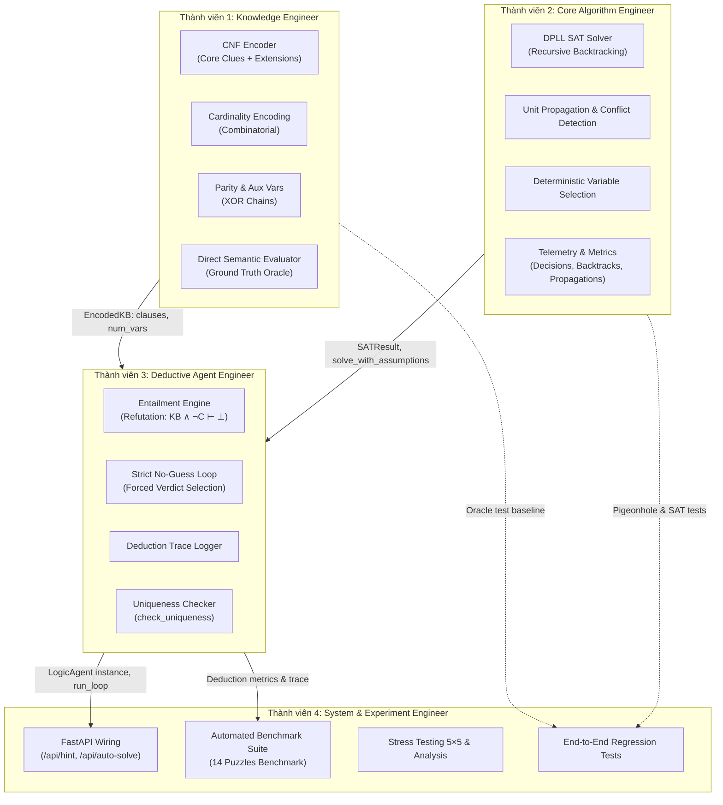

# Griductive Solver — Phân Công Nhiệm Vụ Lập Trình (Nhóm 4 Người)

**Môn học:** CSC14003 — Introduction to Artificial Intelligence  
**Đồ án:** Project 2 — Griductive Solver  
**Phạm vi tài liệu:** 100% phần lập trình và cài đặt mã nguồn (*Coding & Implementation*), không tính phần viết báo cáo và quay video demo.  
**Cơ sở đánh giá:** Đặc tả đồ án `AI - Project 2.pdf` (Khoa CNTT - Trường ĐH Khoa học Tự nhiên, ĐHQG-HCM).

---

## 1. Tổng quan phân bổ công việc theo thang điểm

Phần **Reimplement the Game (Mục 4.1 - 10 điểm)** đã được hoàn thiện đầy đủ trên nền tảng:
- Frontend: TypeScript + React 19 + Tailwind CSS v4.
- Backend & Engine: Python FastAPI + SQLite Database (14 màn chơi đã kiểm định).

Toàn bộ **50 điểm kỹ thuật còn lại** được chia đều cho 4 thành viên (~25% khối lượng code/thành viên) thành 4 module độc lập:

| Thành viên | Vai trò phụ trách | Module code chính | Mục tiêu cốt lõi | Điểm mục tiêu |
| :--- | :--- | :--- | :--- | :---: |
| **Thành viên 1** | **Knowledge Engineer** *(CNF Representation)* | `src/griductive/logic/cnf/` | Biến đổi mệnh đề sang CNF, Cardinality, Parity (XOR chain), Semantic Oracle | 10 pts (Mục 4.2) |
| **Thành viên 2** | **Core Algorithm Engineer** *(DPLL SAT Solver)* | `src/griductive/logic/sat/` | DPLL Solver chuẩn, Unit Propagation, Conflict, Backtracking, Metrics | 10 pts (Mục 4.3) |
| **Thành viên 3** | **Deductive Agent Engineer** *(Logic Agent)* | `src/griductive/logic/agent/` | Entailment classification, Loop không đoán, Trace log, Uniqueness | 20 pts (Mục 4.4) |
| **Thành viên 4** | **System & Experiment Engineer** *(Integration & Tests)* | `scripts/`, `src/griductive/server/` | Nối API Hint/Auto-solve vào GUI, Bộ Benchmark đo đạc 14 màn chơi | 10 pts (Mục 4.5) + API |

---

## 2. Chi tiết nhiệm vụ từng thành viên



---

### Thành viên 1: Knowledge Engineer (CNF Encoding & Representation)
> **Mục tiêu:** Xây dựng module tự động chuyển đổi mọi manh mối logic và trạng thái công khai thành dạng chuẩn hội (CNF) mà không viết tay công thức.

#### Nhiệm vụ cụ thể:
1. **Deterministic Variable Mapping:**
   - Định nghĩa ánh xạ song ánh từ toạ độ nhân vật $(r, c)$ sang chỉ số biến nguyên $1 \dots N^2$:
     $$\text{var\_id}(r, c) = r \times N + c + 1$$
   - Quản lý tách biệt biến chính (Primary variables: $1 \dots N^2$) và biến phụ trợ (Auxiliary variables: $> N^2$).
2. **Core Clue Encoders (6 mẫu bắt buộc):**
   - `FACT`: Biểu diễn dưới dạng mệnh đề đơn $(C_i)$ hoặc $(\neg C_i)$.
   - `SAME`: $(C_i \leftrightarrow C_j) \equiv (\neg C_i \vee C_j) \wedge (C_i \vee \neg C_j)$.
   - `DIFFERENT`: $(C_i \oplus C_j) \equiv (C_i \vee C_j) \wedge (\neg C_i \vee \neg C_j)$.
   - `AT_LEAST(k, R)`: Trong mọi tập con kích thước $|R| - k + 1$, có ít nhất 1 biến True:
     $$\bigwedge_{S \subseteq R, |S| = |R|-k+1} \left( \bigvee_{x \in S} x \right)$$
   - `AT_MOST(k, R)`: Trong mọi tập con kích thước $k + 1$, có ít nhất 1 biến False:
     $$\bigwedge_{S \subseteq R, |S| = k+1} \left( \bigvee_{x \in S} \neg x \right)$$
   - `EXACTLY(k, R)`: Kết hợp $\text{AT\_LEAST}(k, R) \wedge \text{AT\_MOST}(k, R)$.
3. **Extensions (Ít nhất 2 phần mở rộng):**
   - *Extension 1 — Parity Clue:* Mã hoá $\sum_{i \in R} C_i \pmod 2 = \text{EVEN / ODD}$ bằng chuỗi XOR tuyến tính kết hợp biến phụ trợ $y_1, \dots, y_{m-2}$ với độ phức tạp $O(m)$ mệnh đề.
   - *Extension 2 — Vùng phức tạp:* Hỗ trợ `IntersectionRegion` ($R_1 \cap R_2$) và `NeighborsRegion` (8 ô xung quanh).
4. **Direct Semantic Evaluator (Oracle):**
   - Cài đặt `ClueEvaluator`: nhận complete assignment và trả về True/False trực tiếp bằng kiểm tra ngữ nghĩa, không qua CNF. Đóng vai trò ground-truth oracle để kiểm thử tính đúng đắn của bộ mã hoá.

#### File phụ trách:
- `src/griductive/logic/cnf/cardinality.py`
- `src/griductive/logic/cnf/parity.py`
- `src/griductive/logic/cnf/encoder.py`
- `tests/test_cnf_encoding.py`

#### Input/Output Contract:
```python
@dataclass(frozen=True)
class EncodedKB:
    clauses: tuple[tuple[int, ...], ...]
    primary_vars_count: int
    aux_vars_count: int
    variable_map: dict[CellId, int]

class CNFEncoder:
    def encode_knowledge_base(self, state: PublicState) -> EncodedKB: ...
```

---

### Thành viên 2: Core Algorithm Engineer (DPLL SAT Solver)
> **Mục tiêu:** Xây dựng một thuật toán DPLL SAT Solver thuần túy bằng Python, có thu thập đầy đủ chỉ số hiệu năng (decisions, backtracks, propagations, runtime).

#### Nhiệm vụ cụ thể:
1. **Thuật toán DPLL chuẩn (Recursive Backtracking):**
   - **Unit Propagation:** Quét tìm các mệnh đề đơn $(\ell)$, gán giá trị cho $\ell$, xoá các mệnh đề chứa $\ell$, và loại bỏ $\neg \ell$ khỏi các mệnh đề còn lại.
   - **Conflict Detection:** Khi một mệnh đề trở thành rỗng $(\emptyset)$, báo hiệu mâu thuẫn $\rightarrow$ kích hoạt quay lui (backtrack).
   - **Deterministic Variable Selection:** Chọn biến chưa được gán theo thứ tự xác định (nhỏ nhất trước, hoặc theo heuristic DLCS/MOM's có ghi nhận thứ tự).
   - **Recursive Search & Backtracking:** Đệ quy thử nghiệm gán `True`, nếu thất bại thì quay lui và thử nghiệm gán `False`.
2. **Assumption Solving:**
   - Cho phép truyền vào danh sách các literal giả định tạm thời (`assumptions = [literal]`), tự động phục hồi trạng thái sau khi giải xong mà không làm thay đổi tập clauses gốc.
3. **Telemetry & Metrics Logging:**
   - Đếm số lần đưa ra quyết định rẽ nhánh (`decisions`).
   - Đếm số lần lan truyền đơn (`propagations`).
   - Đếm số lần quay lui khi gặp xung đột (`backtracks`).
   - Đo thời gian giải bằng `time.perf_counter_ns()`.
4. **Định dạng kết quả:** Trả về đối tượng chuẩn gồm trạng thái SAT/UNSAT, mô hình nghiệm (nếu SAT) và bộ chỉ số metrics.

#### File phụ trách:
- `src/griductive/logic/sat/dpll.py`
- `src/griductive/logic/sat/__init__.py`
- `tests/test_dpll_solver.py`

#### Input/Output Contract:
```python
@dataclass(frozen=True)
class SolverStats:
    decisions: int
    propagations: int
    backtracks: int
    runtime_ms: float

@dataclass(frozen=True)
class SATResult:
    is_sat: bool
    model: dict[int, bool] | None
    stats: SolverStats

class DPLLSolver:
    def solve(
        self,
        clauses: Sequence[Sequence[int]],
        assumptions: Sequence[int] = ()
    ) -> SATResult: ...
```

---

### Thành viên 3: Deductive Agent Engineer (Logic Agent & Entailment)
> **Mục tiêu:** Xây dựng AI Agent tự động suy diễn theo nguyên lý bác bỏ (Refutation), tuân thủ tuyệt đối quy tắc không đoán mò, ghi nhận vết suy luận và kiểm tra tính duy nhất của nghiệm.

#### Nhiệm vụ cụ thể:
1. **Entailment Engine (Phân loại trạng thái):**
   - Dựa trên $KB_t$ do Thành viên 1 cung cấp và solver của Thành viên 2:
     - $KB_t \models C_i \iff KB_t \wedge (\neg C_i)$ là **UNSAT** $\implies$ $C_i$ là `CRIMINAL`.
     - $KB_t \models \neg C_i \iff KB_t \wedge (C_i)$ là **UNSAT** $\implies$ $C_i$ là `INNOCENT`.
     - Nếu cả hai đều SAT $\implies$ $C_i$ là `UNKNOWN`.
2. **Chính sách không đoán mò (Strict No-Guessing):**
   - Quét tất cả các ô chưa lật theo thứ tự xác định (row-major: A1, B1, ...).
   - Chỉ chọn ô đầu tiên có trạng thái bị ép buộc (`CRIMINAL` hoặc `INNOCENT`). Nếu không có ô nào bị ép buộc, trả về `None` (không đoán).
3. **Deduction Loop & Protocol:**
   - Đưa verdict hợp lệ sang `GameEngine`, nhận manh mối mới.
   - Cập nhật tri thức sang bước $t+1$, tiếp tục vòng lặp cho đến khi toàn bộ bàn cờ được giải quyết.
4. **Deduction Trace Logger:**
   - Ghi lại nhật ký từng bước: số bước, mã manh mối kích hoạt, số câu truy vấn SAT, phán quyết đưa ra, và manh mối mới được mở ra.
5. **Uniqueness Check:**
   - Hàm `check_uniqueness(puzzle)`: giải toàn bộ manh mối ban đầu tìm nghiệm $M_1$. Sau đó thêm mệnh đề phủ định nghiệm $(\neg M_1)$ và giải tiếp. Nếu UNSAT $\implies$ bài toán có nghiệm duy nhất.
6. **Hàm Hint:**
   - Gợi ý đúng 1 ô có thể chứng minh tiếp theo dựa hoàn toàn trên `PublicState`, không đọc dữ liệu ẩn.

#### File phụ trách:
- `src/griductive/logic/agent/models.py`
- `src/griductive/logic/agent/logic_agent.py`
- `src/griductive/logic/agent/__init__.py`
- `tests/test_logic_agent.py`

#### Input/Output Contract:
```python
@dataclass(frozen=True)
class HintResult:
    cell: CellId
    forced_status: Status
    reason: str
    active_clue_ids: tuple[str, ...]

class LogicAgent:
    def suggest_next(self, state: PublicState) -> HintResult | None: ...
    def assess_verdict(self, state: PublicState, cell: CellId, status: Status) -> VerdictAssessment: ...
    def check_uniqueness(self, puzzle: PuzzleDefinition) -> bool: ...
```

---

### Thành viên 4: System & Experiment Engineer (Integration & Benchmarking)
> **Mục tiêu:** Kết nối Logic Agent vào hệ thống Web GUI và xây dựng bộ công cụ thực nghiệm tự động đánh giá hiệu năng trên 14 màn chơi theo yêu cầu Mục 4.5.

#### Nhiệm vụ cụ thể:
1. **Tích hợp Backend API:**
   - Kết nối `LogicAgent` vào endpoint `/api/hint` trong `src/griductive/server/app.py` để phản hồi trực tiếp khi người chơi bấm nút **Hint**.
   - Kết nối `LogicAgent` vào endpoint `/api/auto-solve` trong `src/griductive/server/app.py` để tự động chạy ván chơi và gửi toàn bộ vết suy luận (trace) về bảng Case Evidence trên GUI.
2. **Xây dựng Automated Benchmark Suite:**
   - Viết script `scripts/run_benchmarks.py` tự động nạp và giải toàn bộ **14 màn chơi** trong database `puzzles.db`:
     - 6 màn $3 \times 3$ (Tutorial, Sanity, Regional, Academy, Chain, Daily Hard).
     - 5 màn $4 \times 4$ (Mystery, Four Corners, Chain Alpha, Chain Beta, Scotland Yard).
     - 3 màn $5 \times 5$ (Scalability Masterpiece, Grand Master, Shadows Over London).
   - Thu thập đầy đủ 6 chỉ số bắt buộc theo Mục 4.5:
     1. Số biến chính và biến phụ trợ.
     2. Số mệnh đề CNF (Clause count).
     3. Số lần gọi SAT Solver.
     4. Số lần decisions, propagations, backtracks.
     5. Số bước suy luận (Deduction steps).
     6. Tổng thời gian giải (Runtime in milliseconds).
3. **Stress Testing ($5 \times 5$):**
   - Đánh giá khả năng mở rộng trên lưới $5 \times 5$ (25 nghi phạm), phát hiện hiện tượng bùng nổ tổ hợp hoặc các trường hợp timeout.
4. **Xuất bảng kết quả thực nghiệm:**
   - Tự động xuất file `benchmark_results.csv` và tạo bảng Markdown tổng hợp để nhúng trực tiếp vào báo cáo PDF.
5. **End-to-End Regression Tests:**
   - Viết các test tích hợp toàn diện (`tests/test_integration.py`) đảm bảo toàn bộ hệ thống hoạt động đồng bộ.

#### File phụ trách:
- `scripts/run_benchmarks.py`
- `src/griductive/server/app.py` (wiring `/api/hint` & `/api/auto-solve`)
- `tests/test_integration.py`

---

## 3. Lộ trình thực hiện song song (3 Tuần)

```text
Tuần 1: Phát triển module độc lập (Sử dụng Mock/Contracts)
├── TV 1: Xây dựng CNFEncoder + Combinatorial + Parity + Unit test độc lập
├── TV 2: Xây dựng DPLLSolver + Unit propagation + Backtrack + Unit test với SAT/UNSAT cơ bản
├── TV 3: Thiết kế Agent skeleton, dùng Mock Solver để test luồng Entailment & Loop
└── TV 4: Chuẩn bị khung script run_benchmarks.py và viết test harness

Tuần 2: Tích hợp hệ thống & Kiểm thử chéo
├── Ghép CNFEncoder (TV 1) và DPLLSolver (TV 2) vào LogicAgent (TV 3)
├── TV 3: Kiểm thử Agent chạy thành công trên các màn 3x3 và 4x4
└── TV 4: Nối Agent vào API Web GUI (nút Hint và Auto Solve sáng đèn hoạt động)

Tuần 3: Chạy thực nghiệm & Tối ưu hoá
├── TV 4: Chạy benchmark tự động trên 14 màn chơi, xuất file CSV số liệu
├── TV 1, 2, 3: Phân tích các chỉ số bùng nổ tổ hợp / thời gian chạy trên màn 5x5
└── Nhóm họp đối soát toàn bộ kết quả đo đạc trước khi đưa vào báo cáo
```

---

## 4. Hướng dẫn Stubbing / Mocking để không bị nghẽn

Để 4 thành viên code song song ngay từ ngày đầu tiên mà không cần chờ nhau xong việc:
1. **Thành viên 3 (Agent) chưa có Solver của Thành viên 2:**
   - Có thể viết một class giả lập `DummySolver` trả về kết quả định sẵn, hoặc dùng thư viện chuẩn `pycosat` / `z3` tạm thời để kiểm tra luồng suy diễn logic trước khi chuyển sang DPLL của nhóm.
2. **Thành viên 2 (Solver) chưa có CNF của Thành viên 1:**
   - Có thể tự tạo các tập clauses mẫu số nguyên (như `[[1, 2], [-1, 2], [-2]]`) để kiểm thử thuật toán DPLL hoàn toàn độc lập với game Griductive.
3. **Thành viên 4 (Benchmark/API) chưa có Agent hoàn chỉnh:**
   - Có thể dùng `GameEngine.submit_manual_verdict` với mock actions để test giao diện API trước khi cắm AI Agent thật vào.
